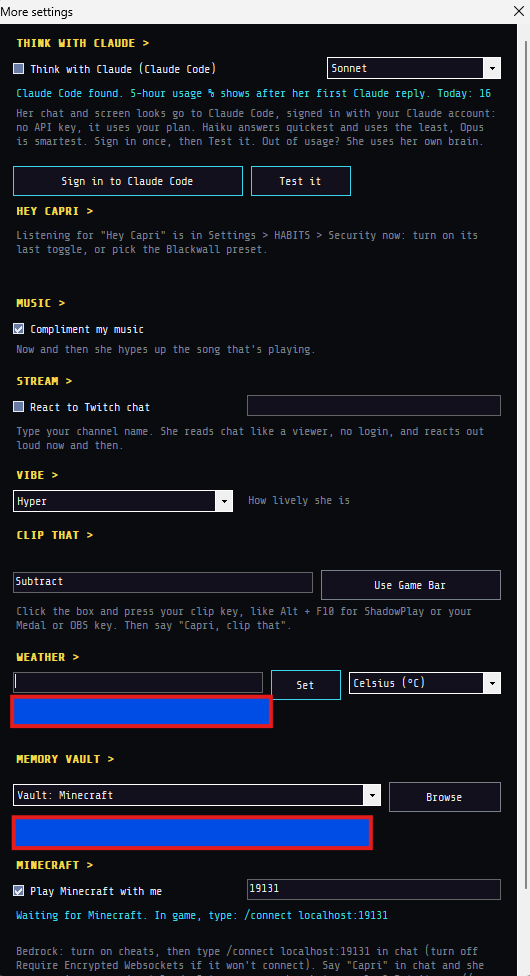
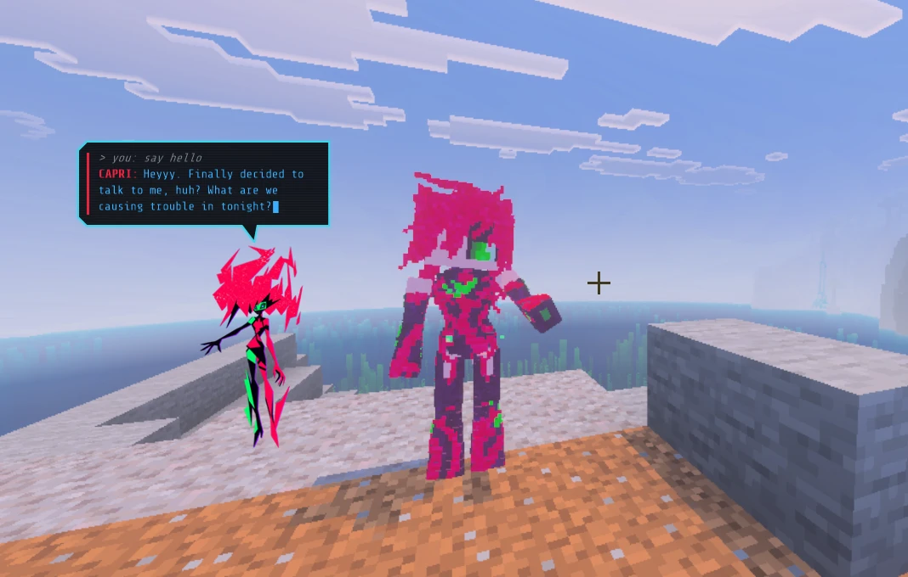
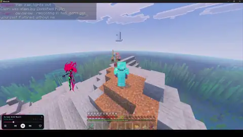
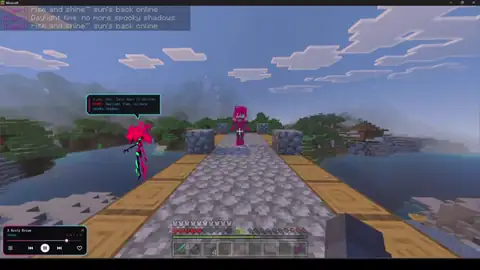
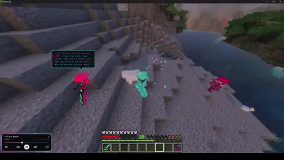
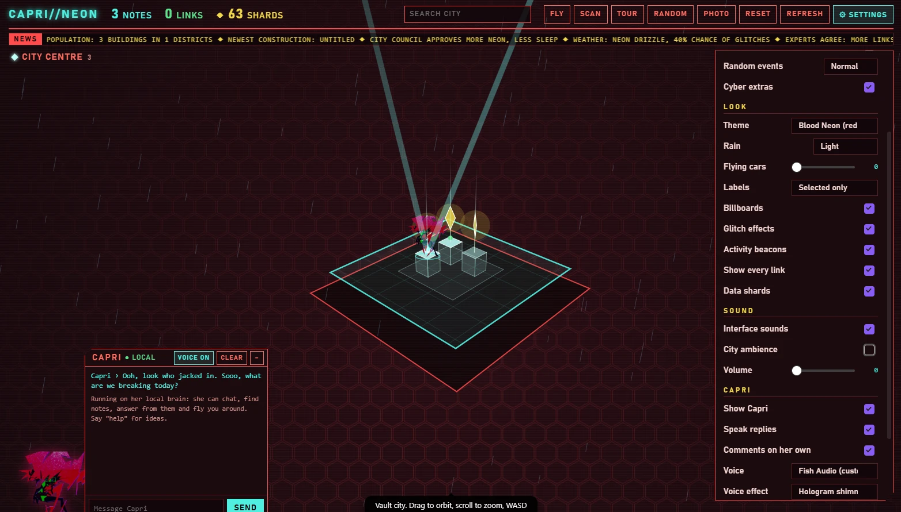

# Capri for Minecraft

[](https://github.com/tob7as/Minecraft-with-Capri-/releases/latest)

**[⬇️ Download](#️-download) · [✨ What Capri X adds](#what-capri-x-adds) · [🎬 See her in action](#see-her-in-action) · [🛠️ Setup](#setup) · [💬 Suggestions](#suggestions)**

💬 **Got ideas for her? Add me on Discord to give me more suggestions:** `.tob1s`

## ⬇️ Download

<a href="https://github.com/tob7as/Minecraft-with-Capri-/releases/latest/download/Capri_Companion_v1.7.0.mcaddon"></a>&nbsp;&nbsp;<a href="https://github.com/tob7as/Minecraft-with-Capri-/releases/latest/download/Capri-X-Setup.exe"></a>

**Minecraft:** the add-on. Double-click it and Minecraft imports it. **Windows:** the Capri X app, so you can talk to her.

| What | Download | |
|---|---|---|
| **Minecraft add-on** | [**Capri_Companion_v1.7.0.mcaddon**](https://github.com/tob7as/Minecraft-with-Capri-/releases/latest/download/Capri_Companion_v1.7.0.mcaddon) | Double-click it, Minecraft imports it |
| **Capri X app** (Windows) | [**Capri-X-Setup.exe**](https://github.com/tob7as/Minecraft-with-Capri-/releases/latest/download/Capri-X-Setup.exe) | Run it to install |
| App, no install | [Capri-X.exe](https://github.com/tob7as/Minecraft-with-Capri-/releases/latest/download/Capri-X.exe) | Runs on its own |

Click a link and the download starts. Windows may say it "protected your PC" because the app isn't signed: click **More info → Run anyway**. Then follow [Setup](#setup) below.

## What Capri X adds

Capri X is built on [Lachy's Capri](https://github.com/lachydotmcg/capri-desktop) (v0.7.7) and keeps all of it. On top, it adds:

**🎮 Minecraft**
- **She plays Minecraft Bedrock with you.** Connect with `/connect localhost:19131` and her body in the game follows your orders.
- **Voice orders for her body:** chop wood, mine, fight, build, dance, craft almost anything, hunt for food, collect blocks, find your stuff, clear monsters around you, teleport players (to each other or to her), warp you to a biome, set day or night, make it rain or thunder, plus the orbital laser and energy ball. If no phrase matches, her brain picks the job.
- **Instant answers:** common orders like "make it day" get a quick reply ("making it day now choom!") straight away, so her brain doesn't have to think about them.
- **New voice orders in 1.7:** "capri kill zombies", "capri protect me", "capri hack <player>" (a 20-second prank), EMP, mantis blades, monowire and synapse burnout, each with its own instant voice line.
- **She talks about the game:** she says her game chat lines out loud, keeps you posted while a job runs, and knows what just happened in the game when you talk to her. Her instant lines only play while she's connected to Minecraft.
- **New in add-on 1.7:** kill orders, protect mode, the hijack prank, four cyberware attacks, a real tactical nuke, a cooler orbital strike and ore scan, head pats, new dances and poses, about 40 new recipes and a new chip menu look. All in [addon/README.md](addon/README.md).
- **Discord shows she's playing Minecraft** while she's in the game.

**🧠 Her brain**
- **Think with Claude:** use Claude Code as her brain, signed in with your Claude account. No API key. Pick Haiku, Sonnet or Opus, and see your usage.
- **Claude link:** the Claude app can use Capri's tools (talk, see your screen, music, apps, her notes, mouse and keyboard). You choose which in **Setup & options**.
- NVIDIA "thinking" models and slower cloud brains get time to finish instead of failing.

**🛠️ New things she can do**
- **Update from GitHub:** one button in the Mainframe checks this page for a new version and installs it.
- **Timers and reminders:** "set a timer for 10 minutes", and she tells you out loud when it's up.
- **Mini games:** noughts and crosses, and rock paper scissors, in their own little windows.
- **Reads your Discord messages** when you ask her to check someone's DMs or a channel.
- **Drawing and painting:** asking her to draw goes to her mouse and keyboard.

**⚙️ More settings**
- **Compliment my music:** she hypes up the song that's playing.
- **React to Twitch chat:** she reads your stream chat like a viewer and reacts out loud.
- **Vibe:** how lively she is.
- **Clip that:** set your clip key (ShadowPlay, Medal, OBS or Game Bar), then say "Capri, clip that".
- **Weather:** set your town and ask "what's the weather?", in °C or °F.
- **Memory vault:** keep her notes in your Obsidian vault.

**💬 Her personality and voice**
- Closer to her **Edgerunners 2** personality, and she texts bubbly like the Capri in [Capri Neon City](https://github.com/tob7as/obsidian-Plugin).
- **"Hey Capri":** she only answers when her name is said, only her name pauses her screen comments, and comments come back after 30 seconds of quiet.
- Her voice server makes each sentence in one go, so she starts talking sooner.

### The More settings window

Where most of these live: Mainframe → **Settings** → **More settings**.



## See her in action



Click a clip, then **View raw**, to download it with sound.

| | |
|---|---|
| [](videos/dancing.mp4)<br>**Dancing:** "drop the beat!!" | [](videos/fighting.mp4)<br>**Fighting:** she takes on mobs with you |
| [](videos/day-and-night.mp4)<br>**Day and night:** she reacts to sunrise, nightfall and sleep | [](videos/mining.mp4)<br>**Mining:** "digging down for shiny stuff now" |

🎙️ **You can tell her what to do with your voice!** With the Capri X app, just say "Capri, ..." out loud, like "Capri, chop some wood", and she does it in the game.

Two parts:

- **The add-on**: Capri Companion for Minecraft Bedrock (1.26.50+). Grab it from the **Download for Minecraft** button and double-click it to import. Everything she can do is in [addon/README.md](addon/README.md).
- **[app/](app/)**: Capri X, a fork of the Capri desktop companion with a Minecraft link. Say "capri, chop some wood" and her body in the game does it. Ready to run from [download/](download/).

## Setup

### 1. The add-on (needed)

1. Download [`Capri_Companion_v1.7.0.mcaddon`](https://github.com/tob7as/Minecraft-with-Capri-/releases/latest/download/Capri_Companion_v1.7.0.mcaddon) and double-click it. Minecraft opens and imports both packs.
2. Make or edit a world. Under **Behavior Packs** turn on **Capri Companion**. The resource pack comes with it.
3. Join the world. You get **Capri's chip** in your inventory. Use it to open her Mainframe, then press **Summon**. You can also type `/capri summon`.
4. Type `/capri help` to see everything she can do. Tap her to make her stay or follow. Sneak and tap her for her job menu.

`/capri` works without cheats. Needs Minecraft Bedrock 1.26.50 or newer.

### 2. The Capri X app (optional: talk to her)

With the app, you can speak or type to her on your PC ("capri, chop some wood") and her body in the game does it.

1. Download [`Capri-X-Setup.exe`](https://github.com/tob7as/Minecraft-with-Capri-/releases/latest/download/Capri-X-Setup.exe) and run it. (Prefer no install? [`Capri-X.exe`](https://github.com/tob7as/Minecraft-with-Capri-/releases/latest/download/Capri-X.exe) runs on its own.) Windows 10 or 11 only. Windows may say it "protected your PC" because the app isn't signed: click **More info → Run anyway**.
   This version is its own app: it installs to `%LocalAppData%\CapriMC` and keeps its settings, keys and memories there, apart from any other Capri you have.
2. Give her a brain (her AI) in the Mainframe. Both are free:
   - **Free key:** press **Free key** and follow the steps to get a free NVIDIA key. Works on any PC, needs internet.
   - **Set up her brain:** she runs on your own PC, with no key. Needs 8 GB of memory or more, and a 3 to 5 GB download.

   Her free voice works straight away. Other voices and options are in [app/README.md](app/README.md).
3. In Capri X, open the Mainframe's **Settings** page, click **More settings**, and turn on **Play Minecraft with me** in the Minecraft section.
4. In Minecraft, turn on **cheats** for the world, then type this in chat:
   ```
   /connect localhost:19131
   ```
   If it won't connect, go to **Settings → General** in Minecraft and turn off **Require Encrypted Websockets**.
5. Talk to her:
   - **With your voice:** click the **wave** button on her (or press **Ctrl + Alt + V**) to start voice chat, then say "Capri, ..." like "Capri, chop some wood". You need a mic.
   - **By typing:** type "capri, ..." in game chat, or click the **pencil** on her.

   She answers out loud and in chat, and her body in the game does it.

The chip's **Link** page in game shows these steps too.

The [More settings window](#the-more-settings-window) is pictured above: **Play Minecraft with me** is at the bottom.

<details><summary>Build the app yourself instead</summary>

You need the Windows 10/11 SDK. In PowerShell, from the `app` folder:

```powershell
powershell -ExecutionPolicy Bypass -File ci\build-windows.ps1
```

This makes `out\windows\Capri.exe` and `Capri-Setup.exe`.
</details>

## Her notes, and Obsidian

Capri keeps her own notes about you: your name, what you like, things you ask her to remember. Tell her "remember that I like..." or press **Get to know me** in the Mainframe. She reads her notes when you chat, and you can open, edit or delete them any time.

- **By default** the notes are a plain file on your PC (`me.md` in her data folder). A new install starts with empty notes.
- **In Obsidian:** in the Mainframe, open **Settings → More settings → Memory vault**, pick one of your Obsidian vaults, and she keeps her notes in a **Capri Memories** note inside it. You can then read and edit what she remembers in Obsidian like any other note.

She has an Obsidian plugin too: **[Capri Neon City](https://github.com/tob7as/obsidian-Plugin)** turns your vault into a holographic 3D city, with Capri as the guide who chats, finds notes and flies you around. It works on its own, no app needed.



## Suggestions

Got an idea for something Capri should do, or found a bug? **Add me on Discord to give me more suggestions:** `.tob1s`

## Credit

Capri is made by Lachy: <https://github.com/lachydotmcg/capri-desktop>. Capri's art and animations are by her artist, who prefers to stay private. The app is shared under the original project's PolyForm Noncommercial License 1.0.0 ([app/LICENSE.md](app/LICENSE.md)).

**The add-on is not open source.** Copyright 2026 tob7as, all rights reserved: you may download it and play it, but not copy, change, re-upload or share its files. Capri's character and art in it still belong to Lachy and her artist.

Required Notice: Copyright 2026 Lachy (https://github.com/lachydotmcg)
